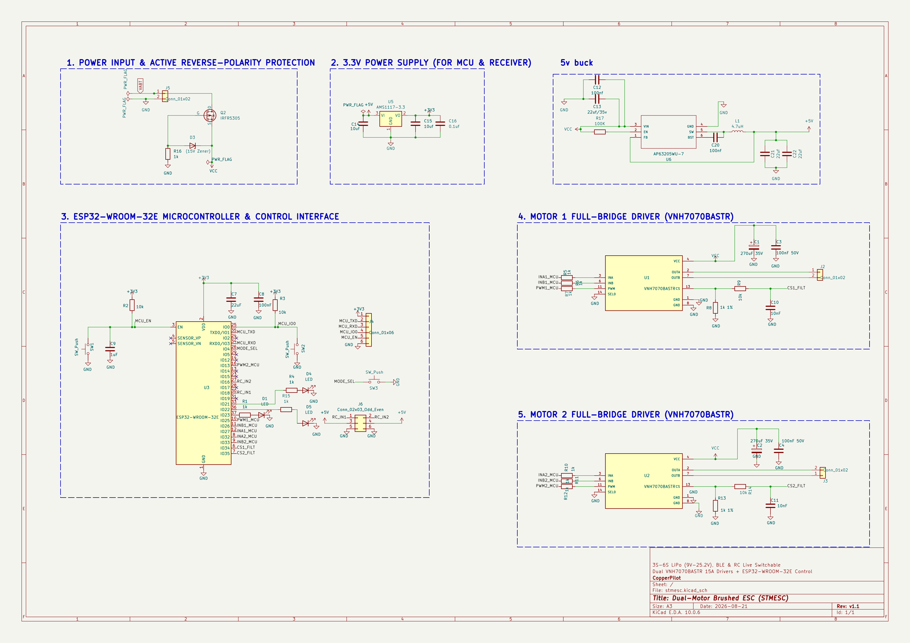

# STMESC - Dual-Motor Brushed Electronic Speed Controller

[](https://kicad.org)
[](https://espressif.com)
[-green.svg)](https://www.st.com)
[-orange.svg)](#power-specifications)
[](LICENSE)
[](#)

**STMESC** is an open-source, high-power dual-channel electronic speed controller designed to drive **two DC brushed motors independently** (up to 15 A per channel) from a **3S to 6S LiPo battery (9.0 V – 25.2 V)**. 

Powered by a **240 MHz dual-core ESP32**, the STMESC features **Tri-Mode Hybrid Control** (Bluetooth LE, Wi-Fi, and standard hobby RC), onboard reverse polarity protection, real-time current sensing with stall detection, and an integrated 5 V / 2 A switching BEC. It is ideally suited for combat robotics, differential-drive rovers, smart RC models, and automation platforms.

---

## 📸 Hardware Previews

<div align="center">
  
  &nbsp;
  
</div>

---

## 🌟 Key Features

* **Dual Independent 15 A H-Bridges**: Dual automotive-grade **STMicroelectronics VNH7070BASTR** drivers with integrated power MOSFETs, charge pumps, and diagnostic logic.
* **3S to 6S LiPo Voltage Range ($9.0\text{ V} - 25.2\text{ V}$)**: Wide input voltage support compatible with 3S ($11.1\text{ V}$), 4S ($14.8\text{ V}$), and 6S ($22.2\text{ V}$) packs.
* **Ultrasonic PWM Drive**: Hardware PWM up to $20\text{ kHz}$ for smooth, responsive, and completely silent motor operation (no high-pitch whine).
* **Tri-Mode Hybrid Connectivity**:
  1. **Bluetooth Low Energy (BLE)**: Low-latency smartphone and gamepad control with live telemetry.
  2. **Wi-Fi Web Dashboard**: Built-in access point and HTTP/WebSocket server for control from any browser without installing an app.
  3. **RC Receiver Input**: Direct hardware pulse decoding for FlySky, FrSky, RadioMaster, ELRS, and Spektrum transmitters.
* **Real-Time Current Sensing & Stall Protection**: Dedicated ST MultiSense current feedback ($K_{sense} \approx 2000$) on both channels for active stall detection and overcurrent limiting.
* **Active Reverse Polarity Protection**: Low-$R_{DS(on)}$ P-Channel MOSFET with Zener gate clamp prevents board destruction if battery leads are reversed.
* **Integrated Dual Power Supply**:
  - **$5.0\text{ V} \text{ @ } 2.0\text{ A}$ Synchronous Buck Converter** (`U6`: AP63205) powers external receivers and sensors.
  - **$3.3\text{ V} \text{ @ } 1.0\text{ A}$ Low-Dropout Linear Regulator** (`U5`: AMS1117-3.3) powers the ESP32 and logic circuitry.
* **Developer & Maker Friendly**: Standard 6-pin UART programming header with auto-bootloader control, on-board tactile buttons (Reset, Boot, Mode), and diagnostic status LEDs.

---

## 📐 System Architecture

```mermaid
flowchart TD
    subgraph PowerStage ["Power Management (3S-6S LiPo: 9V - 25.2V)"]
        BAT["Battery Input J5\n(5.08mm Terminal)"] --> RP["Reverse Polarity Protection\n(Q2 P-MOSFET + D3 15V Zener)"]
        RP --> VCC["Main Rail (VCC: 9V - 25.2V)"]
        VCC --> BUCK["5V 2A Buck Regulator\n(U6: AP63205)"]
        BUCK --> LDO["3.3V 1A LDO Regulator\n(U5: AMS1117-3.3)"]
    end

    subgraph MCU ["Controller Brain (ESP32-WROOM-32E)"]
        LDO --> ESP["ESP32 Dual-Core @ 240MHz"]
        SW["Mode Select Switch (SW3)"] --> ESP
        LEDS["Status LEDs (D1, D4, D5)"] <-- ESP
    end

    subgraph Inputs ["Tri-Mode Control Inputs"]
        BLE["Mode 1: Bluetooth LE\n(Phone App / Gamepad)"] -.-> ESP
        WIFI["Mode 2: Wi-Fi\n(Web Dashboard / Telemetry)"] -.-> ESP
        RC["Mode 3: RC Receiver Header J6\n(Dual Channel PWM / PPM)"] --> ESP
    end

    subgraph MotorDrivers ["Dual ST VNH7070BASTR Drivers"]
        VCC --> U1["Driver 1: Motor 1 (U1)"]
        VCC --> U2["Driver 2: Motor 2 (U2)"]
        
        ESP -- "PWM1, INA1, INB1" --> U1
        ESP -- "PWM2, INA2, INB2" --> U2
        
        U1 -- "MultiSense Current" --> CS1["Current Filter (ADC1_CH1)"] --> ESP
        U2 -- "MultiSense Current" --> CS2["Current Filter (ADC1_CH2)"] --> ESP
        
        U1 --> M1["Motor 1 Output (J2)"]
        U2 --> M2["Motor 2 Output (J3)"]
    end
```

---

## 🔌 Pinout & Connector Specifications

### Power & Motor Terminals (5.08 mm Screw Blocks)
| Connector | Pin | Net Name | Description |
| :--- | :---: | :--- | :--- |
| **`J5`** | 1 | `VABT` | Battery Positive Input ($+9.0\text{ V}$ to $+25.2\text{ V}$) |
| | 2 | `GND` | Battery Negative / Power Ground |
| **`J2`** | 1, 2 | `Net-(J2-Pin_1)`, `Net-(J2-Pin_2)` | Motor 1 Phase Outputs (Bi-directional, up to 15 A) |
| **`J3`** | 1, 2 | `Net-(J3-Pin_1)`, `Net-(J3-Pin_2)` | Motor 2 Phase Outputs (Bi-directional, up to 15 A) |

### Control & Interface Headers
| Header | Pin | Signal | ESP32 GPIO | Description |
| :--- | :---: | :--- | :---: | :--- |
| **`J4` (UART)** | 1 | `+3V3` | - | 3.3 V Power (from onboard LDO) |
| | 2 | `/MCU_TXD` | GPIO1 | ESP32 UART0 Transmit |
| | 3 | `/MCU_RXD` | GPIO3 | ESP32 UART0 Receive |
| | 4 | `/MCU_IO0` | GPIO0 | Bootloader strapping pin (active LOW) |
| | 5 | `/MCU_EN` | EN | Microcontroller Enable / Reset (active LOW) |
| | 6 | `GND` | GND | Logic Ground |
| **`J6` (RC In)** | 1 | `/RC_IN1` | GPIO18 | Channel 1 RC pulse input (Throttle / Motor 1) |
| | 2 | `/RC_IN2` | GPIO16 | Channel 2 RC pulse input (Steering / Motor 2) |
| | 3, 4 | `+5V` | - | $+5.0\text{ V}$ BEC Output (powers external RC receiver) |
| | 5, 6 | `GND` | - | Receiver Ground |

### Tactile Switches & Status Indicators
| Component | Connected To | Function |
| :--- | :--- | :--- |
| **`SW1`** | `EN` / Reset | Hardware reset push button |
| **`SW2`** | `GPIO0` / Boot | Firmware flash bootloader button |
| **`SW3`** | `GPIO4` | Control Mode cycle switch (BLE $\leftrightarrow$ Wi-Fi $\leftrightarrow$ RC) |
| **`D1`** | `GPIO23` | Status Indicator LED 1 |
| **`D4`** | `GPIO21` | Mode Indicator LED 2 |
| **`D5`** | `GPIO22` | Fault / Diagnostic Alert LED 3 |

---

## 🕹️ Motor Truth Table

The ESP32 controls the ST VNH7070 drivers using **`INA`**, **`INB`**, and **`PWM`** logic signals:

| State | INA | INB | PWM | OUTA | OUTB | Motor Action |
| :--- | :---: | :---: | :---: | :---: | :---: | :--- |
| **Forward** | **HIGH** | **LOW** | **PWM %** | $V_{CC}$ (Chopped) | GND | Motor rotates forward; speed proportional to PWM duty cycle |
| **Reverse** | **LOW** | **HIGH** | **PWM %** | GND | $V_{CC}$ (Chopped) | Motor rotates reverse; speed proportional to PWM duty cycle |
| **Brake** | **LOW** | **LOW** | **HIGH** | GND | GND | Dynamic braking: low-side FETs short motor back-EMF |
| **Coast** | **LOW** | **LOW** | **LOW** | High-Z | High-Z | All MOSFETs disabled; motor freewheels to a stop |

---

## 📊 Technical Specifications

| Parameter | Specification |
| :--- | :--- |
| **PCB Form Factor** | $55.0\text{ mm} \times 45.0\text{ mm}$ (2-Layer FR-4, $1.6\text{ mm}$ thickness) |
| **Nominal Input Voltage** | $9.0\text{ V} - 25.2\text{ V}$ (3S, 4S, 5S, 6S LiPo / Li-ion) |
| **Max Continuous Current** | 10 A – 15 A peak per motor channel |
| **BEC Output** | $5.0\text{ V} \text{ @ } 2.0\text{ A}$ (Synchronous Step-Down Buck) |
| **Logic Voltage** | $3.3\text{ V}$ |
| **Current Sense Scale** | ST MultiSense $K_{sense} \approx 2000$ ($I_{sense} = I_{motor} / 2000$) |
| **Supported RC Receivers** | Standard $50\text{ Hz}$ PWM / PPM ($1000\ \mu\text{s} - 2000\ \mu\text{s}$) |
| **Wireless Protocols** | Wi-Fi 802.11 b/g/n (2.4 GHz) & Bluetooth v4.2 BR/EDR and BLE |
| **CAD Environment** | KiCad 10.0+ |

---

## 🗂️ Repository Structure

```text
├── docs/
│   ├── STMESC_Comprehensive_Verification_Report.pdf  # Detailed circuit & DRC audit report
│   └── images/
│       ├── pcb_render.png                            # High-resolution PCB layout render
│       └── sch_render.png                            # High-resolution schematic export
├── enclosure/
│   ├── README.md                                     # Enclosure specifications & print guide
│   ├── stmesc_enclosure.scad                         # Parametric OpenSCAD 3D printable model
│   └── stmesc_enclosure_fusion/                      # Fusion 360 script & CAD manifest
├── manufacturing/
│   └── gerbers/                                      # Production-ready Gerbers & Drill files
├── scripts/
│   └── run_all_tests_and_generate_report.py          # Automated KiCad ERC/DRC verification suite
├── stmesc.kicad_pro                                  # KiCad 10 Project file
├── stmesc.kicad_sch                                  # KiCad 10 Schematic sheet
├── stmesc.kicad_pcb                                  # KiCad 10 PCB layout
├── stmesc.kicad_sym                                  # Project symbol library
├── stmesc.csv                                        # Bill of Materials (BOM) with supplier links
├── stmesc.step                                       # 3D STEP CAD model of assembled PCB
├── .gitignore                                        # Comprehensive KiCad & Python gitignore
├── CONTRIBUTING.md                                   # Contribution guidelines
├── LICENSE                                           # MIT Open Source License
└── README.md                                         # Main documentation
```

---

## 📦 Bill of Materials (Key Components)

| Designator | Value / Part Number | Description | Package | Supplier Reference |
| :--- | :--- | :--- | :--- | :--- |
| **`U1, U2`** | VNH7070BASTR | Dual 15 A Automotive H-Bridge Motor Driver | SOIC-16N | [STMicroelectronics](https://www.st.com) |
| **`U3`** | ESP32-WROOM-32E | Dual-Core 240 MHz Wi-Fi/BLE MCU Module | SMD Module | [Espressif](https://espressif.com) |
| **`U6`** | AP63205WU-7 | 2 A 5 V Synchronous Buck Converter | TSOT-26 | [Diodes Inc](https://www.diodes.com) |
| **`U5`** | AMS1117-3.3 | 1 A 3.3 V Low-Dropout Linear Regulator | SOT-223-3 | Standard OSHW |
| **`Q2`** | SUD50P04-08 / IRFR5305 | -40V / -55V P-Channel Reverse Polarity MOSFET | TO-252 (DPAK) | Vishay / Infineon |
| **`D3`** | BZT52C15-7-F | 15 V 500 mW Zener Gate Protection Diode | SOD-123 | Diodes Inc |
| **`L1`** | 4.7 µH 3 A | Shielded Power Inductor (SWPA5040S) | 5.0x5.0 mm | Sunlord |
| **`C1, C2`** | 220 µF / 270 µF 35 V | Low-ESR SMD Aluminum Electrolytic Capacitor | 8x10.5 mm | Nichicon / Panasonic |
| **`J2, J3, J5`** | MKDS 1,5/2-5.08 | 2-Pin 5.08 mm Pitch Heavy-Duty Screw Terminal | 5.08 mm TH | Phoenix Contact |
| **`SW1-SW3`** | TS-1088-xR025 | SMD Tactile Push Button Switches | 3.9x3.0 mm | Standard SMD |

---

## 🧪 Automated Verification & Testing

This project includes a Python-based automated verification suite located in `scripts/run_all_tests_and_generate_report.py`. It integrates with `kicad-cli` to perform:
1. KiCad Electrical Rules Check (ERC).
2. Design Rules Check (DRC) with tolerance verification.
3. High-current trace thermal ampacity calculations (IPC-2221).
4. ESP32 2.4 GHz antenna keepout clearance checking.
5. Component BOM procurement and distributor availability audit.
6. Automatic generation of `docs/STMESC_Comprehensive_Verification_Report.pdf`.

To run the verification suite locally:
```bash
python scripts/run_all_tests_and_generate_report.py
```

---

## 📄 License

This hardware design and associated software/firmware tools are released under the [MIT License](LICENSE).
Feel free to use, modify, and build upon this design for your personal, educational, or commercial robotics projects!
